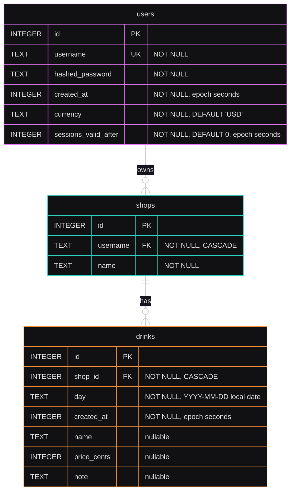

<div align="center">
  

# [Boba Log](https://boba.tomthebomb.dev)

[](https://www.react.doctor/share?p=boba-log&s=100)

</div>

How much boba do you drink? More than you'd admit, probably. Boba Log lets you log every cup in one tap and see the total (and the damage).

## Tech stack

- **App:** Next.js 16 (App Router), React 19, TypeScript, Tailwind CSS 4
- **UI:** `react-aria-components`, `sonner` toasts, `lucide-react` icons, i18next
- **Hosting:** Cloudflare Workers through OpenNext, with D1 (SQLite) for data and R2 for shop pictures
- **Security:** JWT in an HttpOnly cookie (30 days), PBKDF2 password hashes (100k rounds, SHA-256), Turnstile, and per-IP rate limits (10 a minute on auth, 100 elsewhere)
- **Tooling:** Bun, ESLint, Prettier

## Architecture


Run `bun run docs:architecture` to sync `docs/architecture.excalidraw` with README

## Project structure

```text
app/         pages, components, API routes, hooks and providers
lib/         dates, money and stats, plus server code in lib/api
i18n/        English and Chinese translations
migrations/  D1 schema
scripts/     image, texture and font generators
docs/        architecture diagram
```

## Getting started

You need Bun (Wrangler comes with the dev dependencies). Create a `.env` first. Cloudflare's [test keys](https://developers.cloudflare.com/turnstile/troubleshooting/testing/) always pass Turnstile, so they work locally:

```env
JWT_SECRET=your-jwt-secret
NEXT_PUBLIC_TURNSTILE_SITE_KEY=1x00000000000000000000AA
TURNSTILE_SECRET_KEY=1x0000000000000000000000000000000AA
```

Then run:

```bash
bun install
bun run db:migrate:local
bun dev
```

`bun dev` uses local copies of D1 and R2. `bun preview` runs the real Worker against the **remote** ones (production data).

Translations live in `i18n/messages/` and sync with [SimpleLocalize](https://simplelocalize.io) through the `i18n:*` scripts. Those need a gitignored `simplelocalize.yml` with your API key and both paths set to `./i18n/messages/{ns}.json` (`multi-language-json` format).

## Deployment

Every push to `main` runs `bun run deploy` in GitHub Actions. It builds the app, applies pending D1 migrations, then uploads the Worker.

One-time setup: run `bunx wrangler d1 create boba-log` and `bunx wrangler r2 bucket create boba-log`, then create a **Managed** Turnstile widget for your domain in the Cloudflare dashboard.

| Where | Secrets |
| --- | --- |
| GitHub Actions | `CLOUDFLARE_API_TOKEN` (with D1 Edit), `CLOUDFLARE_ACCOUNT_ID`, `NEXT_PUBLIC_TURNSTILE_SITE_KEY` (inlined at build time) |
| Worker | `JWT_SECRET`, `TURNSTILE_SECRET_KEY` |

## Database

The schema lives in [`migrations/`](migrations). Add one with `bunx wrangler d1 migrations create boba-log <name>`. The legacy `shop_dates` table and `shops.total` column are unused and can be dropped later.

<details>
<summary>Schema</summary>



</details>

## Scripts

Run with `bun run <script>`.

| Script | What it does |
| --- | --- |
| `dev` / `build` / `preview` | Dev server, production build, Worker preview on remote data |
| `deploy` | Build, migrate, upload |
| `db:migrate` / `db:migrate:local` | Apply migrations to the remote or local database |
| `assets:process` | Turn images in `public/default-shops` into 256x256 WebP |
| `assets:textures` | Regenerate the paper and mountain textures (needs Chrome) |
| `assets:fonts` | Regenerate the subset Chinese fonts (`pip install -r scripts/requirements.txt` first) |
| `docs:architecture` | Export the architecture diagram to PNG (needs Chrome) |
| `i18n:upload` / `i18n:upload:confirm` / `i18n:download` | Dry run, upload or download translations |
| `lint` / `lint:fix` / `format` / `format:check` | ESLint, Prettier and TypeScript checks and fixes |
| `doctor` | Run [react-doctor](https://github.com/millionco/react-doctor) |

## License

[MIT](LICENSE)
