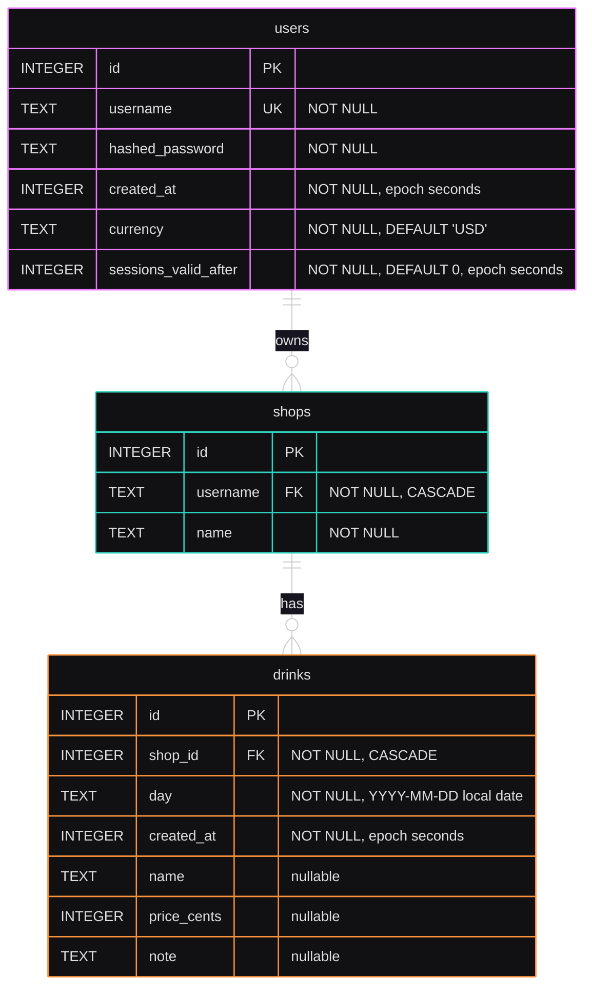

<div align="center">
  

# [Boba Log](https://boba.tomthebomb.dev)

[](https://www.react.doctor/share?p=boba-log&s=100)

</div>

Boba Log is a Next.js app for logging bubble tea drinks. It runs on Cloudflare Workers.

## Stack

- Next.js 16 (App Router), React 19, TypeScript 5, Tailwind CSS 4 and Bun
- Cloudflare Workers through OpenNext, with D1 (SQLite) for data and R2 for shop avatars
- Auth with a JWT in an HttpOnly cookie (30 days), and passwords hashed with PBKDF2 (100k iterations, SHA-256)
- Cloudflare rate limiting and Turnstile against bots
- English and Simplified Chinese with i18next, synced through [SimpleLocalize](https://simplelocalize.io)
- `react-aria-components` for the UI, `lucide-react` icons, `sonner` toasts, and the LXGW WenKai TC and Noto Sans SC fonts

## Local setup

You only need Bun (Wrangler comes with the dev dependencies).

1. Install the packages: `bun install`
2. Create a `.env` in the project root. Cloudflare's [test keys](https://developers.cloudflare.com/turnstile/troubleshooting/testing/) always pass Turnstile, so use them locally:

   ```env
   JWT_SECRET=your-jwt-secret
   NEXT_PUBLIC_TURNSTILE_SITE_KEY=1x00000000000000000000AA
   TURNSTILE_SECRET_KEY=1x0000000000000000000000000000000AA
   ```

3. Create the local database: `bun run db:migrate:local`
4. Start the dev server: `bun dev`

`bun dev` uses local copies of D1 and R2, so it never touches production. `bun preview` builds the real Worker bundle and runs it against the **remote** D1 and R2 (production data), for a final check before deploying.

## Production

Deploy with `bun run deploy`. GitHub Actions runs it on every push to `main`.

Create the D1 database and R2 bucket once (the names match `wrangler.jsonc`):

```bash
bunx wrangler d1 create boba-log
bunx wrangler r2 bucket create boba-log
```

For Turnstile, create a widget in the [Cloudflare dashboard](https://dash.cloudflare.com/) under **Security > Turnstile**, set the domain to your production hostname, and choose **Managed** mode.

Secrets:

- GitHub Actions: `CLOUDFLARE_API_TOKEN` (needs D1 Edit, since deploys run migrations), `CLOUDFLARE_ACCOUNT_ID` and `NEXT_PUBLIC_TURNSTILE_SITE_KEY` (needed at build time, because Next.js inlines `NEXT_PUBLIC_*` variables into the client bundle)
- Worker secrets: `JWT_SECRET` and `TURNSTILE_SECRET_KEY`

Rate limits are per IP: 10 requests a minute on `/api/auth` (except logout), and 100 a minute on every other `/api/` route.

## Database

The schema lives in [`migrations/`](migrations), and `bun run deploy` applies any pending ones to the remote database before uploading the Worker. Create a new migration with `bunx wrangler d1 migrations create boba-log <name>`.

The legacy `shop_dates` table and `shops.total` column are unused and can be dropped in a later migration.



Shop avatars are stored in R2 as `{shopId}.webp` and served by `/api/avatars/[shopId]`.

## Translations

Translations live in `i18n/messages/`. To sync them with SimpleLocalize, install its [CLI](https://simplelocalize.io/docs/cli/get-started/) and create a `simplelocalize.yml` (gitignored, since it holds your API key) with the upload and download paths set to `./i18n/messages/{ns}.json` in `multi-language-json` format.

## Scripts

Run any of these with `bun run <script>`.

| Script | What it does |
| --- | --- |
| `dev` | Dev server with local D1 and R2 |
| `build` | Production build |
| `preview` | Worker build run against remote D1 and R2 |
| `deploy` | Build, apply remote migrations, then deploy |
| `db:migrate` / `db:migrate:local` | Apply pending migrations to the remote or local database |
| `assets:process` | Turn images in `public/default-shops` (`.jpg`, `.jpeg`, `.png`, `.webp`, `.avif` or `.tiff`) into 256x256 WebP, replacing the originals |
| `assets:textures` | Regenerate the paper and mountain textures in `public/textures` |
| `assets:fonts` | Regenerate the subset Chinese fonts in `app/fonts` (run `pip install -r scripts/requirements.txt` first) |
| `i18n:upload` | Dry run of a SimpleLocalize upload |
| `i18n:upload:confirm` | Upload translations to SimpleLocalize |
| `i18n:download` | Download translations from SimpleLocalize |
| `lint` / `lint:fix` | ESLint, Prettier and TypeScript (check, or fix) |
| `format` / `format:check` | Prettier (write, or check) |
| `doctor` | Run [react-doctor](https://github.com/millionco/react-doctor) |
