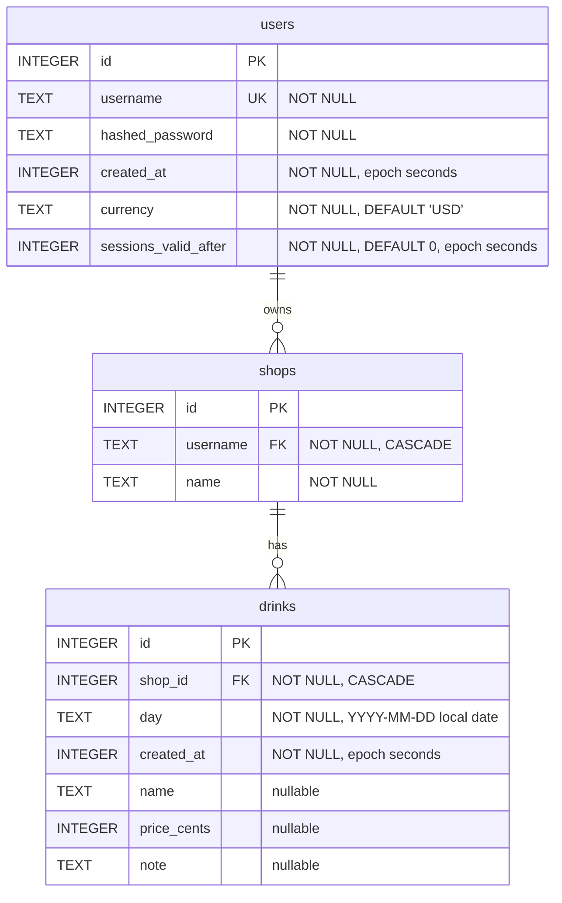

# [Boba Log](https://boba.tomthebomb)

[](https://www.react.doctor/share?p=boba-log&s=100)

Boba Log is a calm, bilingual (English / 简体中文) log for bubble tea, deployed to Cloudflare Workers.

## Features

- **One-tap logging:** tap a shop's +1 to log a drink for today, with undo right in the toast.
- **Any day, any detail:** open any day on the year sheet to add, edit, move or remove drinks, each with an optional name, price and note.
- **Local dates:** drinks belong to the calendar day in your own time zone, not UTC.
- **The year sheet:** every day of the year as a tea drop that grows and deepens with each drink, plus the year painted as an ink-wash handscroll, with month totals, a range summary, spend for priced drinks, and a weekday breakdown.
- **Drinks list:** every entry in the range, filterable by shop and editable inline.
- **Your data:** CSV export, currency setting, password change (signs out other devices) and account deletion.

## Stack

- **Framework:** Next.js 16 (App Router)
- **UI Library:** React 19
- **Language:** TypeScript 5
- **Styling:** Tailwind CSS 4
- **Runtime and Deploy:** Cloudflare Workers (OpenNext)
- **Database:** Cloudflare D1 (SQLite)
- **Object Storage:** Cloudflare R2
- **Package Manager:** Bun
- **Auth:** JWT (100k iterations, SHA-256) via HttpOnly cookie (30-day expiry)
- **Security:** Cloudflare Ratelimiter + Turnstile
- **Localization:** Chinese (simplified) + English with i18next and [simplelocalize.io](https://simplelocalize.io)

### Libraries

- **Components:** `react-aria-components` (unstyled, accessible primitives: calendars, popovers, menus, dialogs, selects)
- **Icons:** `lucide-react` for UI icons
- **Toasts:** `sonner`
- **Fonts:** LXGW WenKai TC and Noto Sans SC, self-hosted from `@fontsource` packages (unicode-range slices)

## Setup

### Prerequisites

- Bun
- Wrangler CLI

### Install

```bash
bun install
```

### Environment

Create a `.env` file in the project root

```env
JWT_SECRET=your-jwt-secret
NEXT_PUBLIC_TURNSTILE_SITE_KEY=your-turnstile-site-key
TURNSTILE_SECRET_KEY=your-turnstile-secret-key
```

For local development, you can use [Cloudflare's test keys](https://developers.cloudflare.com/turnstile/troubleshooting/testing/) which always pass verification:

```env
NEXT_PUBLIC_TURNSTILE_SITE_KEY=1x00000000000000000000AA
TURNSTILE_SECRET_KEY=1x0000000000000000000000000000000AA
```

#### Production

- Github Actions Secrets
  - `CLOUDFLARE_API_TOKEN`
  - `CLOUDFLARE_ACCOUNT_ID`
  - `NEXT_PUBLIC_TURNSTILE_SITE_KEY`
- Cloudflare Workers Secrets
  - `JWT_SECRET`
  - `TURNSTILE_SECRET_KEY`

### Local database

Apply the migrations to the local D1 database for `bun dev`:

```bash
bun run db:migrate:local
```

### SimpleLocalize (i18n)

Translation files live in `i18n/messages/`. The `simplelocalize.yml` config is gitignored since it contains an API key. To set it up:

1. Install the [SimpleLocalize CLI](https://simplelocalize.io/docs/cli/get-started/)
2. Create a `simplelocalize.yml` with your API key and the upload/download paths pointing to `./i18n/messages/{ns}.json` (use `multi-language-json` format)
3. Use the i18n scripts:

```bash
bun run i18n:upload          # dry run upload
bun run i18n:upload:confirm  # upload to SimpleLocalize
bun run i18n:download        # download translations
```

## Development

### `bun dev`

Runs the Next.js dev server with hot reload and local Cloudflare bindings (D1, R2). This is the recommended way to develop, bindings are local emulations so changes are fast and don't touch production data.

```bash
bun dev
```

### `bun preview`

Builds the full Cloudflare Workers bundle and runs it locally via wrangler. Uses **remote** D1 and R2 bindings, so it hits your actual production data. Useful for final verification before deploying.

```bash
bun preview
```

## Database (D1)

This project uses the `D1` D1 binding from `wrangler.jsonc` with database name `boba-log`.

### Create database

Create the D1 database:

```bash
bunx wrangler d1 create boba-log
```

### Migrations

The schema lives in [`migrations/`](migrations) and is applied with Wrangler's D1 migrations, which record what has run in the `d1_migrations` table.

```bash
bun run db:migrate:local   # local database used by `bun dev`
bun run db:migrate         # remote (production) database
```

`bun run deploy` applies pending remote migrations after the build and before the new Worker is uploaded, so the CI deploy migrates automatically. The Cloudflare API token used by CI needs **D1 edit** permission for this step.

To add a migration:

```bash
bunx wrangler d1 migrations create boba-log <name>
```

- `0001_initial.sql` records the schema that existed before migrations; every statement is idempotent, so it is a no-op on the existing database.
- `0002_drink_entries.sql` adds per-drink entries (`drinks`), expands each legacy per-day count into that many entries, and adds `users.currency` and `users.sessions_valid_after`.

The legacy `shop_dates` table and `shops.total` column are no longer read or written; they are kept so the previous release keeps working during rollout, and can be dropped in a later migration.

### Schema



## Object Storage (R2)

This project uses the `R2` R2 binding from `wrangler.jsonc` with bucket name `boba-log` for storing shop avatar images.

### Create bucket

Create the R2 bucket:

```bash
bunx wrangler r2 bucket create boba-log
```

Avatars are uploaded as `{shopId}.webp` and served via the `/api/avatars/[shopId]` API route, which reads directly from the R2 binding.

## Turnstile (Bot Protection)

[Cloudflare Turnstile](https://developers.cloudflare.com/turnstile/) is used to protect the auth and shop creation forms from bots.

### Create widget

1. Create a Turnstile widget in the [Cloudflare dashboard](https://dash.cloudflare.com/) under **Security > Turnstile**
2. Set the domain to your production hostname and choose **Managed** mode
3. Add the site key and secret key as a secret, see [Environment](#environment)

The `NEXT_PUBLIC_TURNSTILE_SITE_KEY` must be available at build time since Next.js inlines `NEXT_PUBLIC_*` variables into the client bundle.

## Ratelimiting

- `/api/auth` route: (10 requests / min / IP)
- All other `/api/` routes: (100 requests / min / IP)

## Default Shop Avatars

Normalize all images in `public/default-shops` to square `256x256` WebP assets:

```bash
bun run assets:process
```

Supported source formats: `.jpg`, `.jpeg`, `.png`, `.webp`, `.avif`, `.tiff`.
Non-WebP source files are replaced with generated `.webp` outputs.

## Deployment

```bash
bun run deploy
```

## Scripts

- `bun run dev` — Next.js dev server with local Cloudflare bindings
- `bun run build` — Production build
- `bun run preview` — OpenNext Cloudflare preview with remote bindings
- `bun run deploy` — OpenNext Cloudflare build, remote D1 migrations, then deploy
- `bun run db:migrate` — Apply pending D1 migrations to the remote database
- `bun run db:migrate:local` — Apply pending D1 migrations to the local database
- `bun run assets:process` — Normalize `public/default-shops` images to `256x256` WebP
- `bun run i18n:upload` — Dry run upload translations to SimpleLocalize
- `bun run i18n:upload:confirm` — Upload translations to SimpleLocalize
- `bun run i18n:download` — Download translations from SimpleLocalize
- `bun run lint` — ESLint + Prettier check + TypeScript no-emit
- `bun run lint:fix` — ESLint fix + Prettier write + TypeScript no-emit
- `bun run format` — Prettier write
- `bun run format:check` — Prettier check
- `bun run doctor` — Run [react-doctor](https://github.com/millionco/react-doctor)
