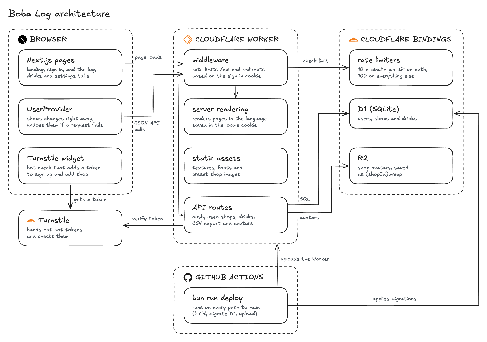
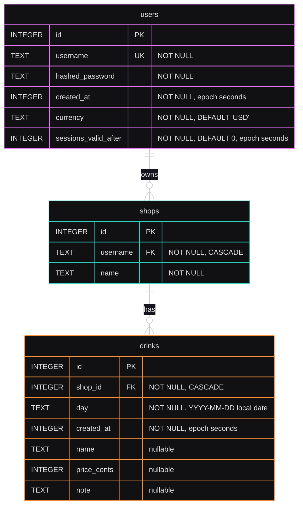

<div align="center">
  
  <h1>Boba Log</h1>

[](https://www.react.doctor/share?p=boba-log&s=100)

</div>

Boba Log tracks how much boba you drink, which is probably more than you'd admit. Log every cup in one tap and see the total (and the damage).

## Tech stack

- **App:** Next.js 16 (App Router), React 19, TypeScript, Tailwind CSS 4
- **UI:** `react-aria-components`, `sonner`, `lucide-react`, i18next
- **Hosting:** Cloudflare Workers (OpenNext), D1 (SQLite), R2 for shop pictures
- **Security:** HttpOnly JWT cookies (30 days), PBKDF2 password hashes (100k rounds), Turnstile, per-IP rate limits (10/min on auth, 100/min elsewhere)
- **Tooling:** Bun, ESLint, Prettier

## Architecture



Run `bun run docs:architecture` to sync [docs/architecture.excalidraw](docs/architecture.excalidraw) with the README.

## Running locally

Needs Bun. Put this in `.env` (Cloudflare's [test keys](https://developers.cloudflare.com/turnstile/troubleshooting/testing/) always pass Turnstile):

```env
JWT_SECRET=your-jwt-secret
NEXT_PUBLIC_TURNSTILE_SITE_KEY=1x00000000000000000000AA
TURNSTILE_SECRET_KEY=1x0000000000000000000000000000000AA
```

```bash
bun install
bun run db:migrate:local  # local D1
bun dev                   # local D1 + R2 (bun preview uses the remote ones)
```

Translations sync with [SimpleLocalize](https://simplelocalize.io) through the `i18n:*` scripts, which need a gitignored `simplelocalize.yml` (API key + paths set to `./i18n/messages/{ns}.json`, `multi-language-json` format).

## Deploying

Pushes to `main` run `bun run deploy` in GitHub Actions: build, apply D1 migrations, upload the Worker.

One-time setup:

```bash
bunx wrangler d1 create boba-log
bunx wrangler r2 bucket create boba-log
```

Then make a **Managed** Turnstile widget in the Cloudflare dashboard and set these secrets:

| Where | Secrets |
| --- | --- |
| GitHub Actions | `CLOUDFLARE_API_TOKEN` (with D1 Edit), `CLOUDFLARE_ACCOUNT_ID`, `NEXT_PUBLIC_TURNSTILE_SITE_KEY` (inlined at build) |
| Worker | `JWT_SECRET`, `TURNSTILE_SECRET_KEY` |

## Database

Schema in [migrations/](migrations). Add a migration with `bunx wrangler d1 migrations create boba-log <name>`. `shop_dates` and `shops.total` are legacy and unused.

<details>
<summary>Schema</summary>



</details>

## Scripts

Run with `bun run <script>`.

| Script | What it does |
| --- | --- |
| `dev` / `build` / `preview` | dev server, production build, Worker on remote data |
| `deploy` | build, migrate, upload |
| `db:migrate` / `db:migrate:local` | apply migrations to the remote / local database |
| `assets:process` | default shop images to 256px WebP |
| `assets:textures` | regenerate the paper and mountain textures (needs Chrome) |
| `assets:fonts` | regenerate the subset Chinese fonts (`pip install -r scripts/requirements.txt` first) |
| `docs:architecture` | export the diagram to PNG (needs Chrome) |
| `i18n:upload` / `i18n:upload:confirm` / `i18n:download` | translations dry run / upload / download |
| `lint` / `lint:fix` / `format` / `format:check` | ESLint, Prettier, `tsc` |
| `doctor` | [react-doctor](https://github.com/millionco/react-doctor) |

## License

[MIT](LICENSE)
